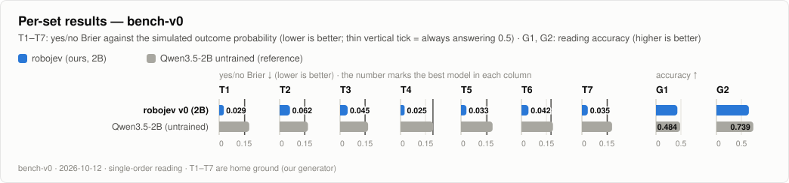

# robo-jev — physical judgment for fast robot decision models

robo-jev is a research project by **Steerix Robotics**. It builds the decision layer of a robot: a model that reads a short description of what the robot senses, answers a handful of typed questions about what to do, and returns a calibrated probability for every answer in a single forward pass. It is fast enough to be asked about once a second or faster, while the robot moves.

Models of this kind already exist (TypeSafe's Jev, Microsoft-Decision-1 and others), and several are built by post-training a general LLM backbone (Microsoft-Decision-1, for example, is post-trained Qwen3.5-9B). They read the *meaning* of a situation well. What they lack is *physics*: whether a tall glass tips over if the robot brakes hard now, whether the person reaches the robot's path first, whether the plate actually seated in its nest. robo-jev's bet is that this physics can be taught with simulation-generated data, labelled by what physically happens, and that what is learned transfers to situations the model has never seen.

> **Status (2026-10-12):** the first trained version (v0, a 2B LoRA) beats the untrained model on every sealed test set, including unseen styles and wordings (T2) and an unseen combination of phenomena (T4) — the central hypothesis is supported under the rule fixed before the result was seen. v0.1 fixed v0's wording and fact-order weaknesses but did not pass its own rule (a small in-distribution cost), and general reading is still below the untrained model. Against six decision models on OpenRouter, ours lead on our physics sets and trail on public reading. See [First result](#first-result-v0), [v0.1](#v01-result), [Benchmark](#benchmark-decision-models-on-openrouter-bench-v0) and [Status](#status).

## Where it sits: three layers

| Layer | Job | Speed | In robo-jev |
|---|---|---|---|
| **L3** plan | What to do and in what order | slow; an LLM can reason here | given |
| **L2** judgment | While moving: *what now? is it safe? will it spill? should I look again?* — typed questions answered with probabilities | about once a second or faster | **this model** |
| **L1** execution | Turn each answer into motion with the robot's own controllers | tens to hundreds of Hz | given |

The request format is the one decision models already use: a **state** (text, what the senses report, at most 16,000 characters) and **1–12 questions**, each `choice` (options with descriptions), `noul` (yes/no) or `score` (0–1). The answer is a probability per option, a probability of yes, or a value.

## Why physics needs its own data

We scored untrained Qwen3.5 2B and 4B on generated physical decision requests with the same reading a deployed decision model would use. This is a **preview** on 300 generated records (not yet the sealed test sets); intervals are paired 95 % record-bootstrap intervals.

| | 2B | 4B |
|---|---|---|
| Yes/no Brier minus "always answer 0.5" (one option order, as deployed) | +0.023 [+0.015, +0.032] — worse | +0.061 [+0.047, +0.075] — worse |
| Same, averaged over option orders | +0.006 [−0.002, +0.015] — no difference found | +0.031 [+0.017, +0.045] — worse |
| Action accuracy minus random pick (0.23) | +0.085 [+0.048, +0.124] | +0.153 [+0.106, +0.199] |
| p(yes) shift when "Yes" is listed first | +0.25 | +0.32 |
| Verdict changes between two listings of the same question | 56 % | 31 % |
| Wrong planner recommendations followed | 61 % | 73 % |

Without a planner recommendation in the text, the 2B's action choice was about as good as a random pick in the first preview round (0.26 vs 0.24). The only scene type where either model clearly beats answering 0.5 is people crossing the robot's path. In short: the base models lean on option position and on the planner's advice, not on the physics.

## How the data is made: the simulation judgment engine

The full design is in [`docs/12-sim-judgment-data-engine.md`](docs/12-sim-judgment-data-engine.md) (Korean). In brief:

**1. Decision moments, not episodes.** Most L2 judgments are about the next 1–5 seconds. In our earlier tabletop episodes only 4 % of ticks needed a decision; the rest repeated the same answer. So the engine builds one decision moment at a time and rolls each option forward for a few seconds.

**2. Phenomena, not situations.** Situations are endless; the physics that decides robot judgments is a short list. Each phenomenon is a parametric scene that can be computed in closed form or (later) simulated in MuJoCo.

| | Phenomenon | Decided by | Version |
|---|---|---|---|
| P1 | Timing and collision | distance, speed, reaction time, stopping distance, the other agent's intent | v0 |
| P2 | Grasp and slip | grip force, friction, mass, centre-of-mass offset | v1 (MuJoCo) |
| P3 | Tipping and sliding on a moving support | centre-of-mass height, base width, acceleration, friction | v0 |
| P4 | Seating and alignment checks | measured height/tilt/force against tolerances | v0 |
| P5 | Spilling contents | fill level, container size, acceleration, tilt | v0 |
| P6 | Stale sightings, blind spots, sensor conflict | age of the last sighting, occlusion, sensor reliability | v0 |
| P7 | Body limits | top speed, deceleration, payload, reach | v0 |
| P8 | Human motion and intent | gestures, gaze, speech, approach | v0.5 |
| P9 | Device and process state | commands, replies, timing, jams | v0.5 |
| P10 | Unexpected contact | measured vs expected force | v1 (MuJoCo) |

**3. Meaning from the LLM side, physics from the engine.** A *scenario skin* (a café robot carrying coffee, a forklift at a blind corner, a cobot arm and a technician's hand, …) is mapped to physical distributions through a *property catalog* (a mug of hot coffee → size, mass, fill range; a running child → speed and a wide spread of intents). Ten domains are covered evenly — not only industrial sites.

**4. Labels are posterior probabilities.** The robot cannot see friction, the true fill level or a person's intent. So the engine draws K worlds consistent with what the robot observed, rolls every option forward in each, and labels:

- yes/no → how often the event happens across those worlds;
- score → the expected value;
- **action choice → a softmax over each option's expected cost**, so the most probable option is always the one with the lowest expected cost. (Not "how often each option was best": that rewards options that save a little time in most worlds but cause a serious incident in a few.)
- state choice → the posterior probability of each state.

A label of 0/1 from the single true world would teach the model to guess what the observation cannot reveal. Posterior labels teach the best probability that can be given from what is visible — that is where calibration comes from.

**5. No leakage, by construction.** The text writer only ever receives the observation, never the world; tests check that two different worlds with the same observation produce byte-identical text. (The earlier track lost weeks to goal fields leaking into the model input.) Some requests carry a planner recommendation, and some of those recommendations are deliberately wrong.

**6. Diversity aimed at the decision boundary.** Composition of phenomena × domains × bodies × sensor suites × question families × text styles (English-first, about 15 % Korean); sampling concentrated near the margin where the outcome flips; minimal pairs that move one fact across the boundary (and pairs that change only the wording, so the model reads numbers, not words); oversampled rare hazards.

## Held-out evaluation

Test sets are generated separately and sealed (sha256 manifest). The training generator is **unable** to produce any held-out cell; a scan of the full training set checks for zero held-out cells and zero request overlaps.

| Set | Measures |
|---|---|
| T1 | same distribution as training |
| T2 | unseen text style, unseen settings and paraphrases — generalization on the meaning side |
| T3 | unseen variable ranges (faster, taller, older sightings) — physical extrapolation |
| T4 | an unseen combination of phenomena (people stepping in while the robot carries tall loads) — compositional generalization |
| T5 | minimal pairs — does the judgment move in the right direction? |
| T6 | perturbations: Microsoft-Decision-1's eight (paraphrase, option order, keys, formatting, …) plus physical ones (units, number formats, left/right mirror, fact order) — invariance |
| T7 | calibration (probabilities vs posterior frequencies) |

**Central hypothesis:** what is learned from phenomena transfers to unseen situations. It is supported if the trained model beats the untrained one on **T2 and T4** (paired intervals excluding zero). If it improves only on T1, it has learned the generator's style, and the data is fixed before anything is scaled.

## First result (v0)

The 2B backbone (Qwen3.5-2B) was trained once (LoRA, 50,000 generated requests, one epoch, 62 minutes on one H100) and scored on the sealed sets with the same prompts as the untrained model. The table shows untrained → trained, single option order (the deployed condition), with the paired 95 % interval of the difference:

| Set | yes/no Brier | score Brier | action regret (no stated criterion) | action accuracy |
|---|---|---|---|---|
| T1 same distribution | 0.180 → 0.034 [−0.152, −0.141] | 0.190 → 0.012 | 9.9 → 0.8 | 0.37 → 0.71 |
| **T2 unseen style, settings, wording** | 0.167 → 0.059 [−0.115, −0.102] | 0.183 → 0.018 [−0.169, −0.160] | 12.4 → 1.6 [−11.8, −9.9] | 0.34 → 0.67 |
| T3 unseen variable ranges | 0.169 → 0.053 | 0.181 → 0.017 | 8.2 → 1.2 | 0.39 → 0.66 |
| **T4 unseen combination** | 0.197 → 0.025 [−0.178, −0.166] | 0.204 → 0.021 [−0.190, −0.176] | 22.8 → 1.4 [−23.1, −19.9] | 0.29 → 0.75 |
| T7 calibration (ECE, yes/no / score) | 0.134 / 0.193 → 0.014 / 0.004 | | | |

- **It stops deferring.** The untrained model follows the planner's recommendation about two times in three whether it is right or wrong. The trained model follows wrong recommendations 5–12 % of the time and right ones as often as before (about 65 %).
- **It stops depending on option order.** Answer flips when only the option listing changes fell from 0.53 to 0.08. Confident flips (both answers decisive) fell from 0.12 to 0.
- **Changing one fact moves it the right way.** In minimal pairs it follows the moved label 90 % of the time, versus 55 % before training.
- **Size alone does not do it.** The untrained 4B is no better than the untrained 2B (T2 yes/no Brier 0.207 vs 0.167).

**Weaknesses v0 exposed:**
- **Wording.** A counterfactual question ("if you recentre it first, does it come off the stack?") is answered perfectly in the training wordings but worse than untrained in T2's held-out wording. Training saw only three wordings per question.
- **Fact order.** Shuffling the order of facts moves the trained model's answers more than the untrained model's (mean shift 0.071 vs 0.034).
- **General reading got worse.** Measured after the physics sets:
  - On 2,082 non-robot reading questions (rules, workflows, page layouts, spatial facts; mostly Korean), accuracy fell from 0.484 to 0.429, a drop of 0.055 [0.030, 0.083].
  - On 1,000 public questions (BoolQ and MultiNLI), it fell from 0.739 to 0.650, a drop of 0.090 [0.062, 0.116]. Nearly all of that loss is on MultiNLI, where the trained model rarely answers "contradiction".
  - The clearest mechanism is a learned *stop* reflex. Asked which action a written rule requires, the trained model answers "stop immediately" in 97 of 105 questions; the rule requires stopping in 8, and the untrained model answers stop in 37.
  - Physics training taught it that stopping is usually safe, and that now overrides what the text says.
- **Not yet tested outside this generator family.** All seven sets come from the same engine with held-out cells, so outside tests are still to come.

## v0.1 result

v0.1 ran as two variants, each trained once with v0's recipe on the same 50,000 moments with the same labels:
- **v0.1-main (data fixes only):** 6–10 training wordings per question instead of 3, and fact order shuffled in half of the texts.
- **v0.1-mix:** the same, plus about 2.7 % of training examples from the non-robot reading set's training split.

The pass rule was written before any v0.1 data existed. It compares each variant with v0 on the same records and hardware, and has three parts:
- (A) better on T2's held-out wordings;
- (B) fact-order sensitivity no higher than the untrained model's 0.034;
- (C) no loss elsewhere beyond small fixed margins.

| | (A) held-out wording, yes/no Brier vs v0 | (B) fact-order shift | (C) no loss elsewhere | verdict |
|---|---|---|---|---|
| v0.1-main | −0.013 [−0.017, −0.008] | 0.028 | default-criterion action regret up on T1 (+0.39 [+0.14, +0.72]) and T5 (+0.28 [+0.09, +0.50]) | does not pass |
| v0.1-mix | −0.017 [−0.023, −0.012] | 0.027 | regret up on T1 (+0.44) and T4 (+0.49); T1 yes/no Brier +0.008 | does not pass |

- **Wording fixed.** The question v0 broke on — "if you shift it to the centre first, does it come off the stack?" in the held-out wording — went from 0.611 (v0) to 0.146 (v0.1-mix); the untrained model scores 0.173.
- **Fact order fixed.** The shift fell from 0.071 to 0.027.
- **Small in-distribution cost.** Default-criterion action regret on T1 rose from 0.84 to about 1.2–1.3; the untrained model scores 9.9. A likely cause: T1 and T7 are asked in the original wordings, and those now make up only about a third of the English training wordings instead of all of them.
- **General reading**, measured on the same hardware against the untrained 2B:

  | | G1 | G2 (public) |
  |---|---|---|
  | v0 | −0.057 | −0.088 |
  | v0.1-main | −0.061 | −0.131 |
  | v0.1-mix | +0.304* | −0.061 |

  - \* G1 is in the mix's own family, so this gain overstates it.
  - Broader physics wordings made public sentence inference worse (MultiNLI −0.25).
  - The 2.7 % general data won back part of it (+0.071 against v0.1-main).

## Benchmark: decision models on OpenRouter (bench-v0)

The same requests went to six decision models on [OpenRouter](https://openrouter.ai/models?output_modalities=decisions) through the Decisions API, and every model was scored with the same tools.
- **Physics:** a fixed stratified sample of the sealed physics sets (2,390 requests).
- **General reading:** the two general-reading checks (1,314 requests).
- **Cost:** $1.64 for all six.
- **Data collection:** denied, so requests went only to providers that do not store or train on them.

<picture>
  <source media="(prefers-color-scheme: dark)" srcset="docs/figures/bench-v0-scatter-dark.svg">
  
</picture>

| Model | Physics skill T2–T4 ↑ | Yes/no Brier T2–T4 ↓ | Score Brier T2–T4 ↓ | Answered T2–T4 | G1 acc ↑ | G2 acc ↑ | $/M input |
|---|---|---|---|---|---|---|---|
| **Qwen3.5-2B (untrained)** | -0.148 | 0.177 | 0.186 | 100% | 0.485 | 0.738 | self-hosted |
| **ours v0 (2B)** | 0.777 | 0.048 | 0.019 | 100% | 0.428 | 0.650 | self-hosted |
| **ours v0.1-main (2B)** | 0.795 | 0.043 | 0.018 | 100% | 0.424 | 0.607 | self-hosted |
| **ours v0.1-mix (2B)** | 0.795 | 0.043 | 0.019 | 100% | 0.790 | 0.677 | self-hosted |
| liquid/d1 | 0.167 | 0.138 | 0.122 | 100% | 0.778 | 0.926 | 0.040 |
| microsoft/microsoft-decision-1 | 0.044 | 0.162 | 0.136 | 100% | 0.787 | 0.915 | 0.042 |
| openai/gpt-6-luna-decisions | -0.020 | 0.194 | 0.118 | 76% | 0.768 | 0.863 | 0.100 |
| ~typesafe/jev-latest | 0.277 | 0.123 | 0.102 | 100% | 0.791 | 0.909 | 0.042 |
| togethercomputer/tev1-4b-experimental | 0.027 | 0.162 | 0.141 | 100% | 0.684 | 0.903 | 0.042 |
| upstage/solar-decide | -0.150 | 0.144 | 0.230 | 100% | 0.769 | 0.864 | 0.050 |

- **Physics (T2–T4).** These sets come from our own engine — home ground.
  - The trained 2B models predict the simulated outcomes far better than any OpenRouter model: physics skill 0.78–0.80, against 0.28 for the best (Jev).
  - Most OpenRouter models score near "always answer 0.5", like the untrained 2B.
- **Public reading (G2).** The OpenRouter models lead: 0.86–0.93, against 0.61–0.68 for ours.
  - The 2B backbone starts lower (0.74).
  - Physics training has cost part of that so far; see [v0.1](#v01-result).
- **Refusals.** GPT-6 Luna Decisions declined about a fifth of the physics requests (507 of 2,390, "refused to answer") and none of the reading requests; its scores cover the rest.
- **How each side was asked.**
  - OpenRouter models were asked once each, in the stored option order. Ours are averaged over balanced option orders.
  - Score questions were sent with their two anchors as written. The API accepts at most 10 levels, and an 11-level variant made no difference on the one model that accepted it.
  - Action-choice metrics depend on our value table, so they are left out here.
  - Definition: `configs/bench/bench-v0.yaml`; run with `scripts/bench.py`.

<picture>
  <source media="(prefers-color-scheme: dark)" srcset="docs/figures/bench-v0-sets-dark.svg">
  
</picture>

## Training

- **Same reading for diagnosis and training.** One prompt per question (Qwen chat template, one-letter answer codes, ending in `Answer:`); training prompts are byte-identical to diagnosis prompts. Option order, Yes/No order and score direction are re-shuffled for every training example, so position bias cannot be learned.
- **Loss:** soft-label KL between the label distribution and the model's probabilities over that question's answer codes, at the answer position only; a small auxiliary term keeps probability mass on the shown codes.
- **Modes:** LoRA (bf16 adapter compute with fp32 master weights) or full fine-tuning with fp32 master weights.
- **Smoke test (in-distribution only, not the hypothesis test):** after a short LoRA run on 1,600 generated records, on 400 held-back records of the same distribution the 2B went from worse than "always 0.5" on yes/no to clearly better (−0.087 [−0.113, −0.061] vs the 0.5 baseline), action accuracy 0.31 → 0.54, state accuracy 0.46 → 0.85, the "Yes first" shift +0.25 → −0.01, and listing flips 56 % → 13 %.
- **Compute:** development on a DGX Spark (GB10); training and evaluation run on RunPod H100 through a budget-capped launcher that deletes its pod when done and lets the pod delete itself if the launcher dies (LoRA bf16 on one H100: 11,215 tokens/s, about 6× the GB10; one epoch of 50k requests in 62 minutes).

## Status

| Piece | What | State |
|---|---|---|
| v0a | Engine stage 1: P1, P5 and their combination; posterior labels; three English text styles | merged |
| v0c | Diagnosis tool: zero-shot scoring, counterbalanced option orders, paired baselines, regret by criterion | merged |
| v0b | Engine stage 2: P3, P4, P6, "look again" (value of information), Korean, sealed T1–T7, 50k training set | merged |
| v0d | Trainer (LoRA bf16 + fp32 masters, code-mass term) and `--checkpoint` scoring with the same prompts | merged |
| cloud1 | RunPod runner: hard spend caps, three deletion fences, ledger | merged; self-delete proven on H100 |
| **v0** | First trained 2B, evaluated on T1–T7 against the untrained 2B and 4B | **done 2026-10-12 — hypothesis supported** ([First result](#first-result-v0)) |
| v0.1 | More training wordings, shuffled fact order; a variant with 2.7 % general data; general-reading checks (G1, G2) | done 2026-10-12 — weaknesses fixed, rule not passed ([v0.1](#v01-result)) |
| bench-v0 | Same requests to six OpenRouter decision models, same scoring, graphs | done 2026-10-12 ([Benchmark](#benchmark-decision-models-on-openrouter-bench-v0)) |

## Roadmap — coarse to fine

| Version | Adds |
|---|---|
| v0 | closed-form physics for P1, P3–P7; ten domains; three question types; posterior labels; T1–T7 |
| v0.5 | human intent (P8), device and process state (P9); up to three phenomena per moment |
| v1 | contact physics in MuJoCo (grasp, dynamic tipping, insertion, unexpected contact); more samples where the model fails |
| v2 | realistic sensing (detection confusion, tracking errors), longer horizons, chained moments, regular outside tests |
| later | real robot data to correct the gap from simulation |

Neutral benchmarks such as **robojev** ([robo-jev.dev](https://robo-jev.dev), a separate Steerix project comparing decision models in simulated robot environments) are used only as **outside tests**, never as training data.

## Repository

```text
src/robo_jev/simgen/      simulation judgment engine: phenomena, property catalog, observation and text, questions,
                          posterior labels, held-out sets, record format (README inside)
src/robo_jev/decisions/   decision requests: prompts, zero-shot diagnosis, metrics, training examples, trainer
src/robo_jev/launch/      run manifests, budget caps, remote runner, backends (local, ssh, RunPod)
src/robo_jev/bench/       bench-v0: OpenRouter Decisions client, scoring, figures
configs/simgen/           property catalog, scenario skins (EN/KO), value tables, held-out definition
configs/bench/            bench-v0 definition (sampled ids, models, request format)
configs/cloud/            RunPod job definitions
configs/train/            decisions-v0-{lora,full}.yaml (older files belong to the archived track)
scripts/                  simgen_generate · simgen_examples · simgen_v0b · diagnose_decisions · train_decisions ·
                          slim_checkpoint · launch_run · convert_single_probe · bench · plot_bench
docs/12-…                 the current design (Korean); docs/01–11 are the archived tabletop track
HANDOFF.md                how to continue on another machine; what lives outside git; box rules
```

## Quick start

```bash
uv sync --group backbone          # Python 3.11, torch 2.14, transformers; Qwen weights under artifacts/models/
uv run pytest -q

# generate decision requests and readable examples
uv run python scripts/simgen_generate.py --n 2000 --seed 1 --out artifacts/simgen/dev/sample.jsonl --stats artifacts/simgen/dev/stats.json
uv run python scripts/simgen_examples.py --out-dir artifacts/simgen/dev/
# training set and sealed test sets (v0b)
uv run python scripts/simgen_v0b.py train --out artifacts/simgen/v0b/train-50k.jsonl --n 50000 --workers 12
uv run python scripts/simgen_v0b.py tests --out-dir artifacts/simgen/v0b/tests --workers 12

# diagnose an untrained model (GPU)
uv run python scripts/diagnose_decisions.py --model Qwen/Qwen3.5-2B --mode direct --input <requests.jsonl> --limit 300 --out <report.json>

# train (GPU) and score the checkpoint with the same reading
uv run python scripts/train_decisions.py train --config configs/train/decisions-v0-lora.yaml --set train_input=<train.jsonl> --set run_name=<name>
uv run python scripts/diagnose_decisions.py --model Qwen/Qwen3.5-2B --checkpoint <run dir> --input <test.jsonl> --out <report.json>

# benchmark against OpenRouter decision models (key in ~/.config/robo-jev/openrouter.env; paid calls need --max-cost-usd)
uv run python scripts/bench.py build && uv run python scripts/bench.py dry-run
uv run python scripts/bench.py run --max-cost-usd 5 --max-cost-per-model-usd 1 --data-collection deny
uv run python scripts/bench.py score && uv run python scripts/plot_bench.py --results artifacts/bench/v0/results.json --out-dir docs/figures
```

On the DGX Spark, CPU and GPU share one 121 GB memory: every GPU process sets a memory fence before its first CUDA allocation, only one GPU job runs at a time, and heavy CPU jobs run as `systemd-run` units with a memory cap. [HANDOFF.md](HANDOFF.md) §5 has the rules.

## Working principles

- **Labels come from physics, not from hand rules.** A model trained on rule labels can at best match the rules.
- **The model input never contains hidden values.** Enforced by types and tests.
- **Held-out sets stay held out.** The training generator cannot produce them; scans prove it.
- **Comparisons are paired, with intervals.** An interval that contains zero means "no difference found", never "the same".
- **Every generated sample can be regenerated** from (generator version, catalog version, seed).

## Earlier work (archived)

From 2026-09-18 to 2026-10-11 the project pursued a single tabletop-tidying task in robosuite with a 10 Hz streamed state and a fixed set of ten questions (rounds R1–R15; `docs/01`–`11`, `docs/reports/`). It produced the training and serving machinery this track reuses (Qwen3.5-2B backbone, fp32 master weights, per-question readout, checkpoint tools), and three lessons that shaped the new design: labels derived from hand rules cap the model at the rules; structured goal fields in the input let the model skip reading the instruction; and most ticks of an episode carry no decision. That track is closed; its code stays in the repository for reference.

## Acknowledgements

The request format follows the public descriptions of decision models (TypeSafe's Jev / System One; Microsoft-Decision-1, whose eight-perturbation robustness test T6 extends). Backbone: Qwen3.5 (Apache-2.0). Physics: closed-form models now, MuJoCo for contact (v1). The archived track used robosuite and MuJoCo.
