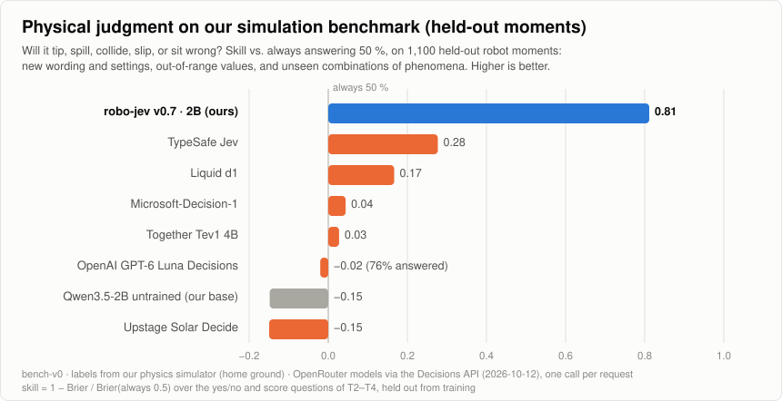

# robo-jev

**A fast, single-pass 2B System 1 for robots' physical judgment.**

<picture>
  <source media="(prefers-color-scheme: dark)" srcset="docs/figures/bench-v0-physics-v07-dark.svg">
  
</picture>

robo-jev reads a short text of what a robot senses and answers the questions that matter in the moment — *will the glass tip if I brake now? does the person reach my path first? did the part seat?* — with a probability for every answer.

| Model | Physical judgment ↑ | General reading (BoolQ + MultiNLI) ↑ |
|---|---|---|
| **robo-jev v0.7 · 2B** | **0.81** | 0.71 |
| TypeSafe Jev | 0.28 | 0.91 |
| Liquid d1 | 0.17 | **0.93** |
| Microsoft-Decision-1 | 0.04 | 0.92 |
| Together Tev1 4B | 0.03 | 0.90 |
| OpenAI GPT-6 Luna Decisions | −0.02 ¹ | 0.86 |
| Upstage Solar Decide | −0.15 | 0.86 |
| Qwen3.5-2B, untrained | −0.15 | 0.74 |

Physical judgment is skill against always answering 50 % (0 = a coin flip, 1 = perfect) on robo-jev's physical-judgment benchmark: 1,100 held-out situations — wordings, value ranges and combinations of phenomena the model never saw in training. The decision models were asked through the [OpenRouter Decisions API](https://openrouter.ai/models?output_modalities=decisions). ¹ It declined about a fifth of the physical-judgment requests; its score covers the rest.

## Why it matters

- **Fast.** One forward pass per question — no sampling, no reasoning tokens. On one L4 GPU a short request answers in about 50 ms, a dozen questions in about 0.1 s.
- **Small.** 2B parameters: it runs beside a robot's planner on a single small GPU.
- **Drop-in.** The Decisions API's request shape — a state text and up to 12 questions — and a calibrated probability for every answer.

## Quick usage

```bash
pip install torch "transformers>=5.17"
hf download Steerix-org/robo-jev-2b robo_jev_decide.py --local-dir .
python robo_jev_decide.py --model Steerix-org/robo-jev-2b --request request.json      # prints the answers as JSON
```

```python
from robo_jev_decide import load

model = load("Steerix-org/robo-jev-2b")
answers = model.decide(state, questions)   # {"action": {"type": "choice", "choice": …, "probabilities": {…}}, "spill": {"type": "noul", "noul": …}, …}
```

**Limits:** `choice` questions with 2–466 options; 1–12 questions per request; state text ≤ 16,000 characters. Options past the 26th get two-letter codes (AA, AB, …) that were not part of training, and the model almost never picks them in the default order; `orders="balanced"` lets every option compete, at one forward pass per option.

*Research preview, tuned on simulated physical judgment; less reliable outside simulation, and not a safety system.*

## Links

- Hugging Face: [Steerix-org/robo-jev-2b](https://huggingface.co/Steerix-org/robo-jev-2b) (merged weights) · [Steerix-org/robo-jev-2b-lora](https://huggingface.co/Steerix-org/robo-jev-2b-lora) (LoRA adapter for Qwen/Qwen3.5-2B)
- The robojev bench: [robo-jev.dev](https://robo-jev.dev)
- This repository: the simulation engine that makes the training data, the training and scoring tools, and the benchmark (`src/robo_jev/`).

## License

Apache License 2.0 — see [LICENSE](LICENSE). Copyright 2026 Steerix Robotics.
