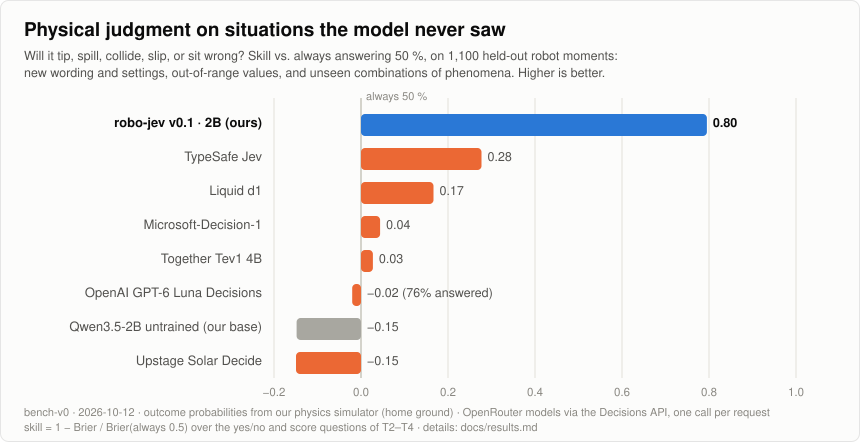
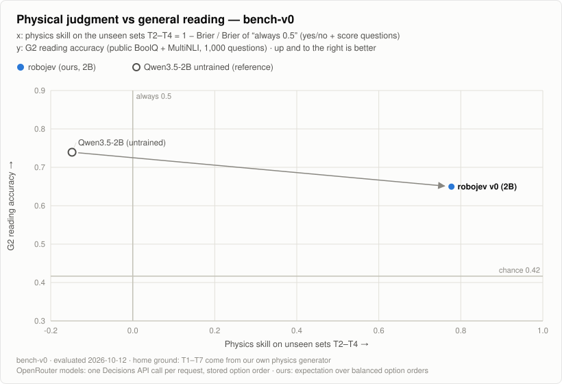

# robo-jev

**A small, fast decision model for robots — specialized in physical judgment.**

robo-jev reads a short text of what a robot senses, answers the questions that matter in the moment — *will the glass tip if I brake now? does the person reach my path first? did the part seat?* — and returns a calibrated probability for every answer in one forward pass of a 2B model.

<picture>
  <source media="(prefers-color-scheme: dark)" srcset="docs/figures/bench-v0-physics-dark.svg">
  
</picture>

General decision models read the *meaning* of a situation well. Most of them do not know the *physics*: on robot moments they have never seen, they score close to always answering 50 %. robo-jev learns physics from simulation and carries it to new wording, out-of-range values and unseen combinations of phenomena.

## Highlights

- **Physical judgment, far ahead.** On 1,100 held-out robot moments, robo-jev scores 0.80 physics skill.
  - TypeSafe Jev, the best general decision model, scores 0.28. Liquid d1 scores 0.17.
  - The rest — Microsoft-Decision-1, Together Tev1 4B, OpenAI GPT-6 Luna Decisions, Upstage Solar Decide — score about zero or below.
- **Learns physics, not phrasing.** The gains hold on:
  - text styles, settings and wordings it never saw;
  - values beyond its training range;
  - combinations of phenomena it never saw together.

  Change one fact and the answer moves the right way 90 % of the time (55 % before training).
- **Calibrated.** Its 70 % means 70 %. Expected calibration error is 0.011 on yes/no questions, against 0.134 for the untrained base.
- **Judges the advice it gets.** It follows a wrong planner recommendation 11 % of the time (65 % untrained) and still follows right ones (67 %).
- **Stable.** Reordering the options flips 6–9 % of answers, against 50–65 % for the untrained base.
- **Small and drop-in.**
  - One forward pass of Qwen3.5-2B with a LoRA adapter, trained in about an hour on one H100.
  - Requests use the same shape as the [OpenRouter Decisions API](https://openrouter.ai/docs/api/api-reference/alphadecisions/submit-a-decisions-request): a state text plus 1–12 `choice`, `noul` (yes/no) or `score` questions.

## What it judges

| Phenomenon | Example question |
|---|---|
| People and robots crossing paths | Does the worker step into my lane before I can stop? |
| Loads tipping or sliding | If I brake hard now, does the tall box topple? |
| Liquids spilling | Does the coffee slop over the rim in this turn? |
| Parts seating and placement | Is the plate actually seated in its nest? |
| Stale or conflicting senses | Is the person I saw 3 s ago still in the way? Should I look again? |

Each answer is a probability, so the robot's planner can weigh risk, time and cost instead of trusting a yes/no.

## How it works

1. **Simulate phenomena, not whole scenes.** An engine samples decision moments across ten domains (warehouses, cafés, hospitals, homes, sidewalks …) and writes them as text in several styles, in English and Korean.
2. **Label with probabilities, not opinions.**
   - What the robot cannot see — mass, friction, reaction time, fill level — is sampled many times.
   - Each answer's label is the probability of the outcome.
   - Actions are labelled by their expected cost.
3. **Hold out what matters.** Sealed test sets cover each kind of novelty, and the training generator cannot produce them:
   - new style, settings and wording;
   - out-of-range values;
   - unseen combinations;
   - one-fact pairs;
   - perturbations.
4. **Train small.** Train a LoRA adapter on Qwen3.5-2B with the same prompts that score it.

More in [docs/method.md](docs/method.md).

## Benchmark

We sent the same requests to six decision models on [OpenRouter](https://openrouter.ai/models?output_modalities=decisions) and scored every model the same way. The test, *bench-v0*, has 3,704 requests:
- 2,390 physics moments from our sealed sets;
- 1,314 general-reading questions, 1,000 of them public (BoolQ, MultiNLI).

<picture>
  <source media="(prefers-color-scheme: dark)" srcset="docs/figures/bench-v0-scatter-dark.svg">
  
</picture>

| Model | Physics skill ↑ | Public reading (BoolQ + MultiNLI) ↑ | $/M input tokens |
|---|---|---|---|
| **robo-jev v0.1 · 2B** | **0.80** | 0.68 | self-hosted |
| TypeSafe Jev | 0.28 | 0.91 | 0.042 |
| Liquid d1 | 0.17 | **0.93** | 0.040 |
| Microsoft-Decision-1 | 0.04 | 0.92 | 0.042 |
| Together Tev1 4B | 0.03 | 0.90 | 0.042 |
| OpenAI GPT-6 Luna Decisions | −0.02 ¹ | 0.86 | 0.100 |
| Upstage Solar Decide | −0.15 | 0.86 | 0.050 |
| Qwen3.5-2B, untrained | −0.15 | 0.74 | self-hosted |

robo-jev is a specialist. It leads on physics by a wide margin; on general reading the larger general models are ahead, and closing that gap is the next step.

- **Physics skill** is 1 − Brier ÷ Brier of always answering 50 %, over the yes/no and score questions of the held-out sets. 0 means no better than a coin flip; 1 is perfect.
- **Home ground.** The physics moments come from our own simulator. They are held out from training, but tests outside this engine are still ahead.
- **One call each.** OpenRouter models were asked once per request through the Decisions API, with data collection denied.
- ¹ GPT-6 Luna Decisions declined about a fifth of the physics requests; its score covers the rest.

All numbers, intervals and caveats are in [docs/results.md](docs/results.md).

## Roadmap

| Next | |
|---|---|
| General reading | mix broader general data into training to close the reading gap |
| Contact physics | grasping, dynamic tipping, insertion and unexpected contact, simulated in MuJoCo |
| People and machines | human intent, device and process state |
| Outside tests | robot environments on [robojev](https://robo-jev.dev), never used for training |
| Real data | correct the simulation gap once robot data exists |

## Quick start

```bash
uv sync --group backbone        # Python 3.11, torch, transformers
uv run pytest -q

# generate decision moments, and train / score a model (GPU)
uv run python scripts/simgen_v0b.py train --out artifacts/simgen/v0b/train-50k.jsonl --n 50000 --workers 12
uv run python scripts/train_decisions.py train --config configs/train/decisions-v0-lora.yaml --set train_input=<train.jsonl> --set run_name=<name>
uv run python scripts/diagnose_decisions.py --model Qwen/Qwen3.5-2B --checkpoint <run dir> --input <test.jsonl> --out <report.json>

# benchmark against OpenRouter decision models (key in ~/.config/robo-jev/openrouter.env)
uv run python scripts/bench.py dry-run
uv run python scripts/bench.py run --max-cost-usd 5 --max-cost-per-model-usd 1 --data-collection deny
uv run python scripts/bench.py score && uv run python scripts/plot_bench.py --results artifacts/bench/v0/results.json --out-dir docs/figures
```

| Path | What |
|---|---|
| `src/robo_jev/simgen/` | the simulation judgment engine |
| `src/robo_jev/decisions/` | prompts, scoring, trainer |
| `src/robo_jev/bench/` | the OpenRouter benchmark |
| `src/robo_jev/launch/` | budget-capped cloud runs |
| `docs/` | [method](docs/method.md), [results](docs/results.md), design notes in Korean (`docs/12-…`); `docs/01`–`11` are an archived earlier track |

## About

robo-jev is built by **[Steerix Robotics](https://github.com/STEERIX-home)**.

- **Request format:** follows the public decision-model APIs — TypeSafe Jev, the OpenRouter Decisions API, Microsoft-Decision-1. The perturbation tests extend Microsoft-Decision-1's.
- **Backbone:** Qwen3.5 (Apache-2.0).
